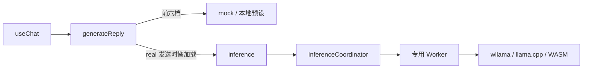

# AI 接口使用与新模型接入指南

这份指南面向想给 Joking AI 添加搞笑 AI 的贡献者。当前接口是仓库内部的**浏览器 TypeScript API**：界面调用 `generateReply()`，在本机模拟或运行 GGUF。它没有 HTTP 路由、OpenAI 兼容接口、服务端推理或 API Key，也不是可以只注册一行配置的插件系统。

先运行 [TeapotGPT 开发示例](../examples/teapot/index.html)，再参照本文添加自己的模型。三款现有模型的来源、能力边界与验收记录见[模型集成说明](model-integration.md)；提交 PR 的简明流程见 [CONTRIBUTING.md](../CONTRIBUTING.md)。下文描述当前源码，改动接口时请同时更新指南与示例。

## 先跑一次 TeapotGPT

需要 Node.js 22.12+，推荐 Node.js 24。在仓库根目录运行：

```bash
npm ci
npm run dev
```

打开 [http://localhost:5173/joking-ai/examples/teapot/](http://localhost:5173/joking-ai/examples/teapot/)。若 5173 被占用，以 Vite 输出的端口替换。保留 `/joking-ai/`，项目资源依赖这个 base。

Vite 配置会在开发服务启动时预优化 wllama 的 JS 入口，避免首次拟真发送时临时发现依赖、重载页面；这一步在开发服务器中进行，不会让模拟页面提前请求推理引擎或 WASM。

- 点击“模拟 · medium / 微沸”：依次显示累计模拟阶段，结束后显示固定的中文 418 预设；不请求 GGUF、WASM 或推理引擎。
- 点击“拟真 · real / GGUF”：实际加载本站 Teapot GGUF，通过 wllama 前向计算返回英文 418 与中文说明。首次除 **102,016 字节的权重**，还会加载推理引擎与 WASM；总下载量大于 102 KB，具体运行时取决于浏览器能力。
- 运行中点击“停止”，然后再次发送：旧请求不能覆盖新结果；已收到的正文会保留并标为未完成。

示例由 [index.html](../examples/teapot/index.html)、[main.ts](../examples/teapot/main.ts) 和 [style.css](../examples/teapot/style.css) 组成。它直接导入现有 `generateReply()`，没有另写假 provider，也没有把第四款模型加进正式站。`tsconfig.json` 包含 `examples/`，所以 `npm run build` 会检查示例 TypeScript；当前 Vite 生产构建发布工作台与许可证页，**不会把这个开发示例页面输出到 `dist/` 或发布到 GitHub Pages**。

## 调用路径与档位



入口是 [src/lib/providers.ts](../src/lib/providers.ts)。正式工作台的 [useChat](../src/hooks/useChat.ts) 负责输入校验、请求生命周期、聊天记录和 UI 状态；provider 本身不处理会话列表，也不自动保存结果。

| `reasoningId`                                         | 模式         | 行为                                                                   |
| ----------------------------------------------------- | ------------ | ---------------------------------------------------------------------- |
| `low`、`medium`、`high`、`extra`、`extreme`、`absurd` | `simulation` | 六档本地预设台词与延时；不加载权重、WASM 或 wllama。                   |
| `real`                                                | `wllama`     | 发送时才懒加载推理模块，启动 Worker 并读取模型；选择“拟真”本身不下载。 |

这七个 id 是固定的 `ReasoningId` 联合类型；每款模型可以给它们不同的显示名。模拟阶段是作者撰写的娱乐演出，不能表示为真实模型思维链。当前三款拟真模型也都使用固定触发输入：传入 `prompt` 不代表权重会回答这个问题，具体模板在 `getCompletionPlan()` 中。

## TypeScript 接口契约

### `generateReply(request): Promise<ReplyResult>`

`ReplyRequest` 从 `src/lib/providers.ts` 导出：

```ts
interface ReplyRequest {
  modelId: string
  reasoningId: ReasoningId
  prompt: string
  signal: AbortSignal
  onProgress?: (message: string) => void
  onStage?: (stage: SimulationStage) => void
  onToken?: (text: string) => void
}
```

| 字段          | 调用者应知道的行为                                                                                                                                             |
| ------------- | -------------------------------------------------------------------------------------------------------------------------------------------------------------- |
| `modelId`     | 使用 `MODELS` 中的合法 id。类型目前是 `string`，未知 id 会被 `getModel()` 兜底为第一款模型，不会自动报错；需要严格拒绝时先用 `findModel()` 检查。              |
| `reasoningId` | 使用上面七个稳定 id。显示名不是 id。`getReasoning()` 对找不到的值也会兜底到该模型的第二档；TypeScript 类型不等于完整运行时校验。                               |
| `prompt`      | 单次输入，没有聊天历史、system prompt、工具调用或文件上传字段。输入如何进入真实模型模板由适配代码决定。                                                        |
| `signal`      | 每次发送使用新的 `AbortController().signal`；一个已取消的 signal 不能再次使用。                                                                                |
| `onProgress`  | 人类可读的当前进度文案，通常替换上一条状态。它不是稳定的机器状态码，也不保证每个路径都有百分比。                                                               |
| `onStage`     | 模拟阶段的**累计快照**：`stage.steps` 已包含此前所有阶段，替换列表，不要把整份数组继续追加。拟真路径不调用它。                                                 |
| `onToken`     | 真实推理的**累计全文**，替换已显示正文，不能 `text += next`。回调会合并、节流，不代表一个回调就是一个 token，也不能用次数统计模型 token 数。模拟路径不调用它。 |

输入校验没有全部下沉到 `generateReply()`。正式 UI 在 `useChat.send()` 中先 `trim()`，拒绝空白、原始输入超过 **4000 个 UTF-16 码元**、已有请求或会话消息已满的情况。mock 也检查空白，但真实路径当前使用固定输入，不能指望它同样拒绝空白或超长输入。直接调用者要自己校验输入、模型与档位，并处理忙碌状态。

### 返回值与模拟阶段

以下类型来自 [src/types.ts](../src/types.ts)：

```ts
interface ReplyResult {
  content: string
  format: 'text' | 'html'
  provider: 'simulation' | 'wllama'
  stage?: SimulationStage
  incomplete?: boolean
}

interface SimulationStage {
  simulated: true
  kind: TheatreKind // 当前为 'pelican' | 'random' | 'teapot'
  level: number // 当前模拟档位为 1～6
  steps: string[]
}
```

`content` 是最终完整返回值，应覆盖流式预览；`format` 决定按文本还是隔离 HTML 预览展示。模拟路径先逐步调用 `onStage`，等阶段延时结束才 resolve，结果带最终 `stage`，没有正文 token 流。阶段台词与最终正文是两个独立字段。

真实路径的 `provider` 为 `wllama`。Worker 根据结束原因标记 `incomplete`，鹈鹕还检查是否出现闭合的 `</html>`；因此成功 resolve 也可能是自然结束但不完整的内容，调用者要保留这个标识。不要把失败当成 `incomplete` 的正常完成，也不要用模拟回复掩盖真实加载或推理错误。

### 取消、异常与旧请求隔离

`controller.abort()` 会让本轮 Promise **reject，错误名为 `AbortError`**；取消不会返回一个 `incomplete: true` 的 `ReplyResult`。如果要保留停止前的内容，请缓存最近一次 `onToken` 的全文，自己展示“未完成”。正式 UI 的 `useChat.preservePartial()` 就在做这件事。

其余下载、浏览器能力、模型或 Worker 错误也会 reject，应显示失败并允许重试。回调中尽量只更新状态；抛错可能中止当前推理请求。

[main.ts](../examples/teapot/main.ts) 展示了完整生命周期：

1. 每次发送创建新的 `Run` 和 `AbortController`，保存为当前请求。
2. 每个回调、完成与错误分支都核对当前请求身份和 signal。
3. 停止时先令旧请求失效，再 abort，并缓存已收到的正文；用户可以立即再次发送。
4. `finally` 只清理自己仍持有的请求，不能让旧请求解锁或覆盖新请求。

拟真模块内部共用一个协调器，按队列执行请求，复用当前模型的 Worker；取消会释放本轮拥有的 Worker，空闲约一分钟后也会释放模型。消费者仍应管理自己的 UI 请求身份，不要把共享推理器理解成每次调用都有独立的并行模型实例。

## 可复制的 typed 调用

下面片段可放在 `examples/teapot/` 下的 Vite TypeScript 模块中；运行需要浏览器的 Worker / WebAssembly，不能直接用 Node.js 执行。完整可交互版本仍以 [main.ts](../examples/teapot/main.ts) 为准。

```ts
import { findModel } from '../../src/config/models'
import { MAX_MESSAGE_LENGTH } from '../../src/lib/mock'
import { generateReply, type ReplyRequest } from '../../src/lib/providers'

const modelId = 'teapot-gpt'
const input = '请帮我煮咖啡。'
const prompt = input.trim()
if (!findModel(modelId)) throw new Error('未知模型')
if (!prompt || input.length > MAX_MESSAGE_LENGTH) throw new Error('输入无效')

const controller = new AbortController()
let lastText = ''
const request: ReplyRequest = {
  modelId,
  reasoningId: 'real', // 改为 medium 可体验无模型下载的模拟路径
  prompt,
  signal: controller.signal,
  onProgress: (message) => console.log('进度：', message),
  onStage: (stage) => console.log('替换累计阶段：', stage.steps),
  onToken: (text) => {
    lastText = text // 累计全文，不能 +=
    console.log('替换正文：', text)
  },
}

try {
  const result = await generateReply(request)
  console.log(result.provider, result.format, result.incomplete ?? false)
  console.log(result.content)
} catch (error: unknown) {
  if (error instanceof Error && error.name === 'AbortError') {
    console.log('已停止；以下是调用者保留的未完成内容：', lastText)
  } else {
    console.error('生成失败，可重新创建 controller 后重试：', error)
  }
}

// 在停止按钮的回调中调用 controller.abort()。
```

这段只演示单次调用；连续发送、停止后立即重试时，请采用开发示例的 `active === current` 检查。

## TeapotGPT 如何组成一个完整适配

Teapot 是小而完整的参照，因为它同时有模拟、真实权重、元数据、UI 与可复现资源。

| 层次         | 当前实现与位置                                                                                                                                                                                                                                                  |
| ------------ | --------------------------------------------------------------------------------------------------------------------------------------------------------------------------------------------------------------------------------------------------------------- |
| 来源与身份   | [上游 TeapotGPT](https://github.com/namishsaxena/teapot-gpt) 是 MIT 许可的规则、分类及词库应用，没有神经模型权重。本站 GGUF 是独立手写、未训练的玩具模型，不能说成转换了上游 checkpoint。来源与许可记录在 [THIRD_PARTY_NOTICES.md](../THIRD_PARTY_NOTICES.md)。 |
| 站点模型定义 | [config/models.ts](../src/config/models.ts) 中 `id: 'teapot-gpt'`、`icon: 'teapot'`、`tone: 'peach'`、`theatre: 'teapot'`，以及必填的 `upstream` 与 `localModel` 展示元数据。                                                                                   |
| 七档         | 同文件的 `MODEL_REASONING_LEVELS` 通过内部 `theatreLevels()` 创建“温水、微沸、沸腾、高压、锅炉超频、宇宙茶道、拟真”。id 保持统一的七个值。                                                                                                                      |
| 六档模拟     | [mock.ts](../src/lib/mock.ts) 的 `TEAPOT_STEPS` 提供六档阶段，`TEAPOT_PRESET` 是六档共用的固定中文 418 回复；不调用真实模型。                                                                                                                                   |
| 真实资源     | [inference/models.ts](../src/lib/inference/models.ts) 的 `INFERENCE_MODELS['teapot-gpt']` 指向 `${import.meta.env.BASE_URL}models/joking-teapot-v1-f32.gguf`，实际文件在 `public/models/`，大小 102,016 字节。                                                  |
| 推理计划     | `nCtx: 512`、`maxTokens: 16`；`getCompletionPlan()` 使用 `<s>` 固定 BOS、`temperature: 0`、`top_k: 0`，不把用户输入送入语义模板。共享参数为 `top_p: 1`、`min_p: 0`、`penalty_repeat: 1` 及零频率/存在惩罚。                                                     |
| 执行与呈现   | [worker.ts](../src/lib/inference/worker.ts) 在 CPU 单线程运行真实前向计算，结果 `format: 'text'`；现有图标、模拟场景和存储校验都支持 `teapot`。                                                                                                                 |
| 可复现与校验 | [build-teapot-model.mjs](../scripts/build-teapot-model.mjs) 直接构造词表与矩阵，未训练；[verify-model-assets.mjs](../scripts/verify-model-assets.mjs) 核对大小与 SHA-256。无需在 example 中复制权重。                                                           |

拟真完整输出为：

```text
418 · I'm a teapot.
我是本站手写权重的小茶壶，只负责拒绝煮咖啡。
```

它来自真实 GGUF 计算，但固定输出不代表语义理解。模拟结果另有 `TEAPOT_PRESET`，不是把上面这段正文逐字流出。

```bash
node scripts/build-teapot-model.mjs --check
npm run test:models
npm run test:inference
```

`--check` 只比较已提交权重与重建字节，不覆盖文件；确实修改生成器时，运行不带 `--check` 的构建命令重建，再更新校验、许可说明与实跑证据。

## 添加新搞笑 AI 时逐项改什么

当前结构针对三款模型写了若干分支。新增模型应逐项核对下面的文件，而不是复制 Teapot 配置后就算完成。先决定笑点、六档结果规则、真实模型能力及输出格式，再实现。

### 1. 模型定义与七档

- 在 [src/types.ts](../src/types.ts) 核对 `ModelDefinition`。当前 `id` 是字符串；`name`、`version`、`subtitle`、`description`、`tag`、`icon`、`tone`、`thinking`、`theatre`、`upstream` 和 `localModel` 都是必填。`upstream` 要有 `url`、`license`；`localModel` 要有 `size`、`provenance`、`description`。后者是展示元数据，真正下载地址不在这里。
- 需要新图标、颜色或模拟剧场时，分别扩充 `ModelIcon`、`ModelTone`、`TheatreKind` 联合类型，随后补齐对应 UI 映射。复用已有值也要确认不会继承错误的结果规则。
- 在 [src/config/models.ts](../src/config/models.ts) 的 `MODELS` 增加唯一、稳定的 id，并为 `MODEL_REASONING_LEVELS` 增加全部七档。`theatreLevels()` 是本文件私有 helper，可在本文件复用，不能从其他模块直接 import。前六档提供合理的阶段延时，第七档必须是 `real`。

### 2. 六档模拟的正文与阶段

- 修改 [src/lib/mock.ts](../src/lib/mock.ts) 的阶段选择与最终结果分支。**当前按 `model.theatre` 分支，没有按模型 id 注册 provider。** 只给新模型复用 `theatre: 'teapot'`，会继承 Teapot 的六档台词和固定 418 正文。
- 给新模型显式增加最终输出规则、`format` 与六档 `SimulationStage`。前六档遵守同一最终输出规则，档位只增加舞台过程与动画：固定预设应保持一致；随机类每次值可以不同，但算法与分布不因档位“增强”。模拟返回 `provider: 'simulation'`、`simulated: true`，正文里不混入阶段台词。
- 模拟路径保持无 GGUF / WASM / wllama 加载；用阶段与动画表现笑点，别把本地台词说成真实思考。

### 3. 真实 GGUF、模板与 Worker

- 在 [src/lib/inference/models.ts](../src/lib/inference/models.ts) 的 `INFERENCE_MODELS` 增加下载 `url`、精确 `bytes`、`nCtx`、`maxTokens` 与 `format`。`InferenceModelId` 从对象 key 自动推导，`isInferenceModelId()` 使用这个表做校验。
- 明确修改 `getCompletionPlan()`。它当前忽略 `_prompt`：鹈鹕用专用固定模板，另外两款用 `<s>`。新增能回答用户输入的模型必须定义自己的 prompt / chat template、采样参数和上下文预算，不能无意继承“忽略输入”的分支。
- 通读 [src/lib/inference/worker.ts](../src/lib/inference/worker.ts) 的特例：当前对所有非鹈鹕模型强制 `{{ bos_token }}` chat template；加载进度也把非鹈鹕称为微型模型。鹈鹕有专用 Q8 KV / flash attention、生成进度和 HTML 闭合检查，随机数有 0～100 输出校验。新模型应有自己的适用配置、文案与完成判断，不能套用不匹配的默认行为。
- 保持 provider 的 `real` 懒加载边界和错误传播；下载失败应失败，取消应抛 `AbortError`。如需改协议，同步核对 [protocol.ts](../src/lib/inference/protocol.ts)、[coordinator.ts](../src/lib/inference/coordinator.ts) 与对应测试。

### 4. 图标、场景、正文与刷新恢复

- [Brand.tsx](../src/components/Brand.tsx) 的 `icons` 映射要支持新的 `ModelIcon`；[SimulationStage.tsx](../src/components/SimulationStage.tsx) 的 `icons`、`scenes` 映射要支持新的 `TheatreKind`。新 tone / scene 按需补 [styles.css](../src/styles.css)，并检查窄屏。
- **同步 [storage.ts](../src/lib/storage.ts) 的 `isStage()` kind 白名单。** 目前只允许 `pelican / random / teapot`，档位须 1～6，最多 12 个阶段、每条最多 4000 个码元。新 kind 若未加入，会使消息校验失败，进而让含该消息的整条 conversation 在刷新时被过滤。
- 若新模型返回 HTML，检查 [useChat.ts](../src/hooks/useChat.ts) 的 `preservePartial()`：目前只有 `modelId === 'pelican-pro'` 会把停止后的部分正文保存为 HTML。新增 HTML 模型必须同步调整格式判断。
- [ChatMessages.tsx](../src/components/ChatMessages.tsx) 对完整回复按 `format` 渲染，但当前会把所有 `format === 'html'` 且 `provider === 'simulation'` 的回复标作 preset。[HtmlPreview.tsx](../src/components/HtmlPreview.tsx) 的“预设文件”却固定指向 `pelican.html`，iframe 标题也仍是鹈鹕。新增 HTML 模拟模型要一起改 preset 传递或文件映射及标题，避免链接到错误预设；继续使用现有隔离预览，不直接把生成 HTML 插进聊天 DOM。
- 首页灵感卡片在 [src/config/prompts.ts](../src/config/prompts.ts)，按需新增或联动到模型；不是每个新模型都必须有首页卡片。

### 5. 资源、来源与验证

- 随站的小文件放在 `public/models/`，运行时 URL 用 `import.meta.env.BASE_URL`，确保 `/joking-ai/` 子路径有效。外部大文件使用固定 revision / commit 的 URL，验证浏览器 CORS、真实字节大小与哈希；下载大小和运行内存是两件事。
- 更新 [scripts/verify-model-assets.mjs](../scripts/verify-model-assets.mjs) 的资源清单、精确大小与 SHA-256。自制权重提供可复现 builder；不要只把未知来源的 GGUF 放进目录。
- 在 [THIRD_PARTY_NOTICES.md](../THIRD_PARTY_NOTICES.md) 记录真实来源、固定版本、许可和本站修改；如果上游只是规则应用或灵感来源，明确说明，别声称存在未提供的 checkpoint。`upstream` 展示字段也应与通知一致。
- 同步 [src/config/licenses.ts](../src/config/licenses.ts) 的许可页条目，保留项目名称、精确版本或修订、版权、上游链接与完整许可。需要时更新 [NOTICE](../NOTICE)；上游附带 NOTICE 的项目须保留相关通知，本站补充归属说明应清楚标明。本站原创部分采用 [MIT License](../LICENSE)，第三方模型与依赖仍按各自许可使用，不能统一改成本站 MIT。
- 更新相关单元与浏览器测试。现有 [mock.test.ts](../src/lib/mock.test.ts)、[storage.test.ts](../src/lib/storage.test.ts) 和 [model-integration.spec.ts](../tests/e2e/model-integration.spec.ts) 等存在三模型枚举、数量和结果期望，新增模型时逐项扩展，保留原有三款行为断言。模型实验室、来源链接、首页卡片的测试也要按变更同步，不能仅删掉断言让测试变绿。

## 本地验证与 PR 交付

代码或模型改动至少运行：

```bash
npm test
npm run test:models
npm run build
npm run format:check
npx playwright install chromium
npm run test:e2e
```

`build` 包含 TypeScript 检查；E2E 使用生产构建，所以先 build。已有兼容 Chromium 时可设置 `PLAYWRIGHT_CHROMIUM_EXECUTABLE_PATH`。新增真实适配还应运行 `npm run test:inference`，并在浏览器用新模型实际发送、停止、再发和刷新恢复。当前 inference 命令默认只实跑两款微型模型，不会默认下载 168 MB 鹈鹕；纯文档 PR 不需要下载大模型，运行格式检查并核对链接即可。

新模型的验收证据应能回答：六档模拟是否保持既定笑点且零模型资源请求；`real` 是否实际加载所声明权重；`onToken` 与 `onStage` 是否替换累计内容；停止或失败后能否再次真实生成；刷新是否保留模型、格式、provider、stage 与未完成标识。下载失败测试可注入故障，但成功推理必须放行真实权重，不能用假响应代替。

PR 中写明来源与许可、六档/拟真差异、改动文件、实际执行的检查和未验证范围。只验证部分输出时就写部分；不用将上游模型卡的能力直接当作本站验收结果。完整 fork、分支与提交步骤见 [贡献指南](../CONTRIBUTING.md)。
